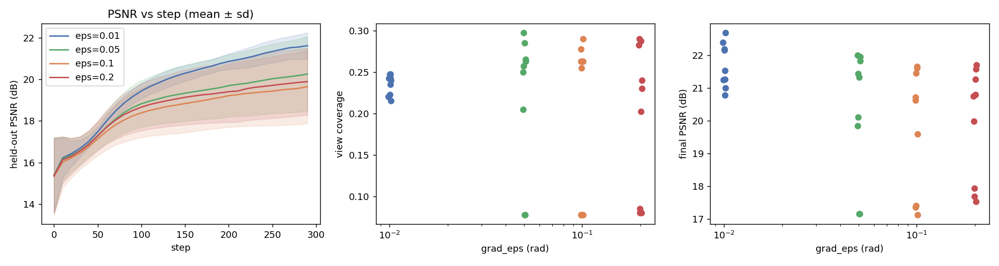
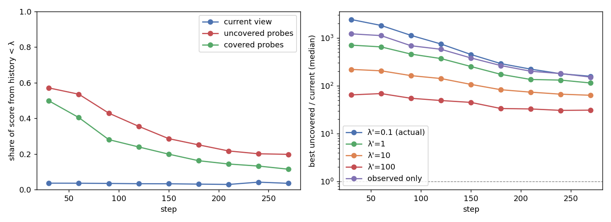

# 仿真报告：探测步长 `grad_eps` 扫描 + Fisher 分数来源诊断（2026-10-18）

承接 [nbv_ablation.md](nbv_ablation.md)。读完 Misimi, Herland, Chaumette, "Visual Servoing-Based Active Vision
for 3D Object Reconstruction"（RA-L）后提出了两个问题：

1. 他们的中心差分探测步长约 0.2 rad（25 cm 球上 δ=5 cm），我们是 0.01 rad。**更大的探测步长能不能带来前瞻、
   缓解局部梯度的近视？**
2. 消融里停止判据从不触发，因为全局探测分数是历史峰值的 1.3–180 倍。**这个差距是不是来自从未被观测的高斯？**
   它们的 history≈0，分母只剩 λ=0.1，贡献会被放大。如果是，就应该先改目标函数，而不是做"重定位"。

**结论先行：**

- **问题 1：否。** 加大步长让终态 PSNR 下降 1.4–2.0 dB（95% CI 不含 0）。主要原因是低起点被压在可行性带下沿动不了；
  其余起点的 PSNR 没有可分辨的差异。eps=0.01 是四档里唯一在三次重复间梯度方向可复现的一档。
- **问题 2：基本否定。** 未观测元素只贡献远处方向分数的约三分之一；把 λ 放大 1000 倍，或者只算已观测元素，
  "远处更多"的差距都还在。1.3–180 倍这类大比值的主因是另一件事：**Fisher 分数随视角离已访问轨迹的角距离急剧上升**，
  当前位姿永远处在这个"碗"的碗底。碗外两个方向之间公平比较，差距只有约 5 倍。
- **对之前结论的更正：** 视角覆盖低（0.24）主要是**路径预算**不够，不是近视。46° 弧长的路径最多能覆盖 0.275，
  策略实际达到了这个上限的 78–90%。

## 设置

和 [nbv_ablation.md](nbv_ablation.md) 的 `full_no_stop` 臂完全相同，只改 `--grad_eps`：

- 场景 `phase2/instance_gs.ply` + `--recolor texture` + 2 m 地面；配置 `sim/ablation/sim_ablation_config.yaml`（关闭周期性 opacity reset）。
- 策略 `gradient_space=tangent` + `feasibility`（φ∈[15°,80°]）+ `fisher_mask`（ROI = 真值物体包围盒，**特权信息**）
  + `velocity_mapping: normalized`（v_nominal=0.05 m/s）。停止判据关闭，所有 run 跑满 300 步（dt=0.1）。
- eps ∈ {0.01, 0.05, 0.1, 0.2} rad × 起点 {s20, s45, s70} × **3 次重复** = 36 个 run。参考球半径 0.89 m，
  所以 0.2 rad ≈ 18 cm 弧长，覆盖了 Misimi 的角步长。
- 运行不是确定性的（见消融报告"噪声水平"），所以每格都重复 3 次。有 3 个 run 在 TSDF 体素查询处 CUDA OOM，
  原样重跑后成功（OOM 日志保留为 `stdout_oom_attempt1.log`）。
- 诊断（实验 2）和实验 1 在同一批 run 里进行（`--contrib_diag_every 30`）。每 30 步对三类视角打分，只读、不改地图：
  当前视角、它在参考球上的投影，以及 φ∈[15°,80°] 内 24 个 Fibonacci 方向。每个视角的分数按参数元素的
  history 分桶求和。
- 复现：

```bash
bash sim/ablation/run_eps_contrib.sh sim/sim_outputs/eps_contrib 300 3   # 约 5 h，串行
python sim/ablation/analyze_eps_contrib.py sim/sim_outputs/eps_contrib
```

## 实验 1：`grad_eps` 扫描



| eps (rad) | n | 终态 PSNR (dB) | PSNR 曲线均值 (dB) | 视角覆盖 | 路径 (m) | 最高仰角 (°) |
|---|---|---|---|---|---|---|
| **0.01** | 9 | **21.69 ± 0.68** | **19.60 ± 0.29** | 0.235 ± 0.012 | 0.71 ± 0.01 | 65.7 ± 4.0 |
| 0.05 | 9 | 20.31 ± 1.94 | 18.79 ± 1.31 | 0.220 ± 0.085 | 0.56 ± 0.27 | 54.0 ± 19.5 |
| 0.1 | 9 | 19.73 ± 1.93 | 18.39 ± 1.41 | 0.205 ± 0.096 | 0.48 ± 0.30 | 50.6 ± 24.0 |
| 0.2 | 9 | 19.91 ± 1.72 | 18.61 ± 1.33 | 0.197 ± 0.092 | 0.51 ± 0.28 | 45.7 ± 21.4 |

相对 eps=0.01 的差（均值差，95% bootstrap CI）：

| eps | 终态 PSNR，全部起点 | 终态 PSNR，s45+s70 | 视角覆盖，s45+s70 |
|---|---|---|---|
| 0.05 | −1.38 [−2.73, −0.18] | −0.25 [−1.01, +0.46] | +0.03 [+0.01, +0.04] |
| 0.1 | −1.96 [−3.25, −0.76] | −0.39 [−1.09, +0.24] | +0.03 [+0.02, +0.04] |
| 0.2 | −1.78 [−2.94, −0.68] | −0.32 [−0.92, +0.25] | +0.01 [−0.01, +0.04] |

逐起点（3 次重复的均值）：

| eps | s20 PSNR | s20 覆盖 | s20 被压在下沿 | s45 PSNR | s70 PSNR |
|---|---|---|---|---|---|
| 0.01 | 22.42 ± 0.25 | 0.219 | 0/3 | 21.64 ± 0.46 | 21.01 ± 0.24 |
| 0.05 | 18.78 ± 2.79 | 0.120 | 2/3 | 21.74 ± 0.27 | 20.42 ± 0.79 |
| 0.1 | 17.30 ± 0.15 | 0.077 | 3/3 | 21.57 ± 0.10 | 20.32 ± 0.62 |
| 0.2 | 17.73 ± 0.20 | 0.082 | 3/3 | 21.36 ± 0.49 | 20.66 ± 0.65 |

### 发生了什么

**s20 的分岔。** 起点 φ=20°，离可行性带下沿只有 5°。

- **eps=0.01**：三次重复第 0 步的北向梯度都是 **+1e6**，相机一路爬到 φ≈65°。
- **eps≥0.1**：三次重复都是 **−3e8 到 −7e8**，幅值大 300 倍以上，符号相反。中心差分为负，说明
  f(φ−eps) > f(φ+eps)，即更低仰角那一侧分数更高。eps=0.1 时下侧探测点在 14.3°，eps=0.2 时在 8.5°，
  都已经落在可行性带外。可行性投影削掉了"往外"的分量，剩下的切向分量几乎为零，于是相机贴着 φ=15° 停住：
  路径 0.09 m，中位速度约 0.001 m/s，PSNR 平台在 17.3 dB。
- **eps=0.05**：下侧探测点在 17.1°，仍在带内。三次重复里有两次也往下走，说明问题不只是"探测点越界"。
  在大尺度上，靠近桌面的一侧本来就分数更高（这就是消融里原版冲向 φ=0 的那股拉力）。大步长让梯度看见了这个大尺度趋势，
  而可行性带把它变成了出不去的边界。

**其余起点。** PSNR 差异在噪声内。视角覆盖小幅上升（+0.03，CI 不含 0），但没有转化为质量。

**可复现性。** 第 0 步北向梯度的符号在 3 次重复间：

- eps=0.01：3/3 个起点完全一致；
- eps≥0.05：只有 1–2/3 个起点一致，例如 s70 在 eps=0.05 时是 (+, −, −)。

大步长下两个探测点都落在下文所说的"碗"外，比较的是两个碗沿上的大数。这两个大数对地图的细小差异很敏感，
符号就跟着运行噪声翻转。

**结论。** 保留 `grad_eps=0.01`。Misimi 那套步长在他们的目标函数（体素熵）上可行，搬到我们的 Fisher 场上不行。
小步长并不是"更聪明"：它跟随的是碗底的局部斜率，这个斜率总是指向离开已访问轨迹的方向，在这里恰好朝北。
如果将来确实需要更大的探测范围，探测点必须先夹到可行性带内（未实现、未验证）。

## 实验 2：Fisher 分数从哪里来

运行时的打分是 `LogFisherEvaluator`：对每个参数元素（布局 `[xyz(N·3), opacity(N)]`）算
`w · log1p(cur) / (history + λ)` 再求和，其中 λ=0.1，history = Σ_关键帧 log1p(raw)，w 是 mask。
这里把 history < λ 的元素称为**未观测**：它的分母主要由 λ 决定。



| eps | 快照数 | 未观测元素占 mask 内元素 | 当前视角分数中未观测占比 | 已覆盖方向中 | 未覆盖方向中 | 最佳未覆盖方向中 |
|---|---|---|---|---|---|---|
| 0.01 | 81 | 0.170 | 0.042 | 0.220 | 0.298 | 0.311 |
| 0.05 | 81 | 0.178 | 0.032 | 0.220 | 0.322 | 0.337 |
| 0.1 | 81 | 0.182 | 0.032 | 0.280 | 0.367 | 0.385 |
| 0.2 | 81 | 0.182 | 0.032 | 0.247 | 0.367 | 0.389 |

（"已覆盖 / 未覆盖" = 离最近已访问视角方向 ≤25° / >25°，和 stop 判据的覆盖定义相同。）

### 1. 未观测元素不是主因

- 未观测元素约占 mask 内参数元素的 18%，贡献了未覆盖方向分数的约 30–39%。这个比例随时间下降，从约 57% 降到约 20%（左图）。
- **反事实：换分母。** 用同一批贡献向量把分母换成 history+λ'，重新求和（这是重加权，不是重跑闭环）。
  加大 λ' 等价于给每个元素的贡献加上限 cur/λ'，也就是之前设想的"给目标函数加饱和"：

  | 最佳未覆盖 / 最佳已覆盖（中位数 [四分位]，n=324） | λ'=0.1（实际） | λ'=1 | λ'=10 | λ'=100 | 只计已观测元素 |
  |---|---|---|---|---|---|
  | 全部快照 | 4.81 [2.76, 10.12] | 4.24 [2.62, 8.00] | 3.71 [2.35, 6.31] | 2.83 [1.89, 5.17] | 4.57 [2.75, 7.93] |
  | 步 210–270 | 3.59 [2.27, 8.80] | 3.53 [2.23, 7.03] | 2.93 [2.06, 5.34] | 2.35 [1.71, 4.28] | 3.64 [2.31, 7.36] |

  λ 放大 1000 倍，比值只从 4.8 降到 2.8，差距被压缩到约 0.6 倍但消除不了；只计已观测元素时比值基本不变（4.6）。
  之前设想的"先给目标函数加饱和"不成立。

### 2. 真正的结构：围绕已访问轨迹的"碗"

把每个探测方向的分数除以当前视角的分数，再按它离最近已访问方向的角距离分桶（全部 36 个 run，第 30 步以后的快照）：

| 离已访问方向 | 探测数 | 分数 / 当前视角（中位数 [四分位]） | 来自未观测元素的占比 |
|---|---|---|---|
| 0–5° | 147 | 0.8 [0.7, 1.2] | 0.03 |
| 5–10° | 102 | 3.7 [1.7, 20.2] | 0.05 |
| 10–15° | 451 | 22.8 [7.0, 140.0] | 0.15 |
| 15–25° | 559 | 62.3 [28.5, 344.9] | 0.16 |
| 25–40° | 1274 | 130.0 [39.4, 795.4] | 0.23 |
| 40–60° | 1907 | 212.9 [64.0, 1102.6] | 0.28 |
| 60–90° | 2200 | 234.0 [25.8, 5941.0] | 0.35 |
| 90–180° | 1136 | 2054.0 [229.6, 9999.7] | 0.54 |

分数随离已访问轨迹的角距离单调、急剧上升：

- 在仍算"已覆盖"的 15–25° 处已经是当前视角的 60 倍；
- 增长主要来自**已观测元素**：一个元素从关键帧里被斜着看过（history 小但 >λ），换一个视角正面看时 log1p(cur) 大得多；
- 未观测元素只在 >90° 的对面才占到一半。

这个现象有一个直接后果：**当前位姿永远在碗底。**

- stop 判据 A 的"局部饱和"是拿碗底的分数和历史上碗底分数的峰值比，几乎必然成立；
- "全局确认"是拿碗外的探测分数和碗底的峰值比，碗的深度就有两三个数量级，几乎不可能低于 0.1。

所以消融报告里的 1.3–180 倍**衡量的是碗的深度，不是"别处的信息比已收集的多"**。在碗外的两个方向之间做公平比较
（上表"最佳未覆盖 / 最佳已覆盖"），差距是 3.6–5.4 倍。

### 3. 视角覆盖受路径预算限制

参考半径 0.89 m，300 步 × 约 0.024 m/s ≈ 0.71 m，只相当于 46° 的弧。用和 StopMonitor 相同的 400 方向、25° 邻域计算：

- 一条最优的 46° 大圆路径最多能覆盖 **0.275**；
- 单个视角本身就占 0.125；
- eps=0.01 的实际覆盖是 0.215–0.25，达到上限的 78–90%。

消融报告"停止判据"一节把"300 步只覆盖 17–31%"归因于近视，这个归因**不成立**：在这个时间预算下，
局部梯度已经接近这条路径长度能达到的覆盖。这也和 Misimi 等人的结果一致：他们的 Hybrid（局部 + 全局重定位）
相比纯局部只带来边际收益。

## 结论与建议

**能成立的：**

1. 加大 `grad_eps` 不带来前瞻收益。在低起点上它会把相机钉在可行性带下沿（−1.4 到 −2.0 dB，CI 不含 0），
   并让梯度方向在重复之间不可复现。保留 0.01。
2. 远处方向分数更高，不是 λ 放大未观测高斯造成的：λ 放大 1000 倍或只计已观测元素，差距都还在。
3. Fisher 分数是一个围绕已访问轨迹的陡峭的"碗"，当前位姿永远在碗底。
4. 覆盖率受路径预算限制，不是近视。

**建议：**

- **停止判据 A 要换参照。** 不要拿碗底的分数当分母，改成"未覆盖探测 vs 已覆盖探测"的同半径比较，
  例如最佳未覆盖 / 最佳已覆盖 < 阈值。照现在的写法它永远不会触发。阈值仍需标定。
- **重定位（Hybrid）暂缓。** 在固定路径预算下它不会提高覆盖率。等速、等路径比较时更值得先看速度
  （`v_nominal`）和时间预算。
- **大步长要先处理可行性。** 如果要探索更大的探测步长，探测点必须先夹到可行性带内。

**不能成立 / 未验证的：**

- 只有单个物体，只在仿真里做，每格 3 起点 × 3 次重复。
- mask 用的是真值包围盒。
- λ' 反事实是对同一批贡献向量的重加权，没有用不同的 λ 重跑闭环：闭环行为和关键帧都会变。
- "碗"的形状是在参考球、φ∈[15°,80°] 的 24 个方向上测的，没有覆盖带外和不同半径。
- s20 下侧探测点为什么分数更高（猜测是看到了物体底部未观测的部分）没有直接验证。

## 代码

- `sim/contrib_diagnostics.py`：诊断模块。
- `sim/sim_fisher_closed_loop.py`：新增 `--contrib_diag_every` / `--contrib_diag_dirs`，默认 0，即关闭、行为不变。
- `sim/ablation/run_eps_contrib.sh`：批量运行脚本。
- `sim/ablation/analyze_eps_contrib.py`：分析脚本。
