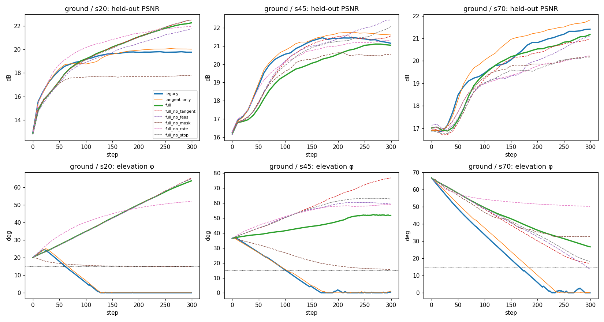

# 主动视角策略：四项修复与消融

实现：[`omnimap/gaussian/renderer/nbv/policy_improvements.py`](../omnimap/gaussian/renderer/nbv/policy_improvements.py)
（由 `FisherMotionPolicy` 的 `nbv_config` 接入）。配置：`config/*.yaml` 的 `nbv_policy` 节。

## 背景

原版策略直接跟随 FisherRF 信息增益的局部梯度。这个准则原本是为"在自由空间候选集里挑一张图"设计的，
不需要可行性、速度尺度和停止条件；拿来驱动受约束的连续运动时，这三样都成了必需，对应三类观察到的问题：

| 现象 | 根因 | 修复（开关） |
|---|---|---|
| 北极附近打转 | (θ,φ) 参数化下 θ 自由度按 cos²φ 塌陷 | `gradient_space: tangent`（`6b99a62` 已有） |
| 冲向半球边缘 / 桌下 | 打分对**全部**高斯求和，桌面/背景高斯和不可达视角的"信息"无法兑现却在拉相机；梯度不知道哪里可达 | `fisher_mask`（ROI + 支撑面可见性）+ `feasibility`（仰角带 / 工作空间切锥投影） |
| 速度尺度靠试、常撞限幅 | 梯度幅值直接当速度，同一 `fisher_step_scale` 在不同场景下速度差两个数量级 | `velocity_mapping: normalized` |
| 没有停止信号 | 只有 `spherical_speed_min`（真机为 0） | `stop`（饱和 / 覆盖 / 预算 / 停滞，取或） |

## 四项修复的定义

**1. 可行性 `feasibility`**：对每个约束（仰角下限、上限、可选的相机位置盒的六个面）给出外法向 `n` 和激活度
`s∈[0,1]`（离边界 `margin` 以内线性升到 1）。对指令切向速度做 `v ← v − s·max(0, v·n)·n`，只削掉"往外"的分量，
往里走不受影响；`hard_clamp` 再把积分出的位姿夹回仰角带。作用在所有输出分支共用的二维速率上，所以
cartesian / spherical_rate / angular 三条路径都继承。

**2. 可见性掩码 `fisher_mask`**：贡献向量 `cur/(history+λ)` 按 `[xyz(N·3), opacity(N)]` 布局逐元素乘权重：
ROI 盒外、支撑面以下的高斯权重为 0；相机低于支撑面时整幅打分乘以 sigmoid 门（被桌面挡住）。
这是用支撑面近似 TSDF 遮挡，不是逐高斯的 TSDF 光线投射。

**3. 速率映射 `velocity_mapping: normalized`**：梯度只给方向，速率与梯度绝对尺度无关：

```
direction = g / |g|
speed     = v_nominal · |g| / (|g| + κ),   κ = |g| 的滑动中位数（窗口 kappa_window）
```

把场整体放大 10⁴ 倍，指令完全不变（单元测试 `test_rate_mapper_is_scale_invariant`）；`v_nominal` 是有物理意义的
m/s，`linear_vel_max` 退回安全兜底。

**4. 停止判据 `stop`**（满足任一即停，触发后锁存）：
- A 信息饱和：当前视角的 Fisher 分数滑动均值 < `score_ratio` × 历史最大滑动均值只算**提名**；再给最多
  `global_probe_views` 个未覆盖的可达方向打分，其最大值也低于阈值、且连续 `confirm_checks` 次确认才停
  （贪心策略停在局部最优时，当前视角的分数也会衰减，单看局部会误停）
- B 视角球覆盖：仰角带内 Fibonacci 方向中，落在某个已访问视角 `coverage_radius_deg` 以内的比例 ≥ `coverage_threshold`
- C 预算：步数 / 路径长 / 时间（真机用墙钟）
- D 停滞：指令切向速度连续低于阈值（默认关）

覆盖判据用相机位姿而不是 TSDF 权重：当前 TSDF 后端不暴露逐体素积分权重。

## 配置与回退

`nbv_policy` 全部关闭（或整节缺省）= 原版实现。回归验证：默认配置与改动前 HEAD 的 `motion_policy`
在 angle/tangent × cartesian/spherical_rate/angular 共 447 步上**逐位一致**。

```yaml
nbv_policy:
  gradient_space: tangent          # angle = 原版
  feasibility:      {enabled: true, phi_min_deg: 15, phi_max_deg: 80}
  fisher_mask:      {enabled: true, roi_bounds: tsdf, support_plane_z: tsdf_min_z}
  velocity_mapping: {mode: normalized, v_nominal_mps: 0.03}
  stop:             {enabled: true}
```

- `roi_bounds: tsdf` / `support_plane_z: tsdf_min_z` 取 `tsdf.spatial_bounds`；仿真里可用 `object` / `object_min_z`（物体 AABB）。
- 仿真命令行覆盖：`--nbv_config file.yaml`、`--nbv_set fisher_mask.enabled=true`（可重复）；`--gradient_space` 仍有效且优先。
- 真机两个规划入口（`info_flow_planning_node.py`、`info_flow_node.py`）读取同一节。**真机侧只同步了代码，未上机验证**；
  真机配置里窗口按 30 Hz 规划 tick 计（`score_window: 300`、`min_steps: 600`），预算用墙钟。

## 运行消融

```bash
bash sim/ablation/run_nbv_ablation.sh sim/sim_outputs/nbv_ablation 300 1   # 输出目录 步数 并行数（地面场景单进程峰值约 14 GB，3090 上只能串行）
python sim/ablation/analyze_nbv_ablation.py sim/sim_outputs/nbv_ablation
python tests/test_nbv_policy_improvements.py                              # CPU/GPU 均可，无需 pytest
```

需要 InfoFlow 环境（含 `modified_diff_gaussian_rasterization`）；omnimap 环境里没有这个包。

---

# 消融报告（2026-10-17，仿真）

## 设置

- 场景：`sim/sim_outputs/phase2/instance_gs.ply`（单物体，包围盒对角线 0.70 m），`--recolor texture`；
  **ground** = 物体下方加 2 m 灰色地面（桌面的仿真替身），**noground** = 无地面对照。
- 起点：(θ, φ) = (0°, 20°) / (120°, 45°) / (241°, 70°)，记作 s20 / s45 / s70；每臂每起点 1 次（仿真确定性，无随机种子）。
- 300 步，dt=0.1，`linear_vel_max=0.05 m/s`，`v_nominal=0.05 m/s`；地图配置 `sim/ablation/sim_ablation_config.yaml`
  （= sim 配置，仅关闭周期性 opacity reset，见附录 B）。
- 指标：16 个固定**留出视角**（φ∈[10°,80°]，不喂给建图）上、**只在物体像素**上算的 PSNR；表面完整度
  （GT 点 1 cm 内有高斯的比例）；视角球覆盖（φ∈[15°,80°] 内 25° 邻域被访问到的比例）。
- 臂：`legacy`（原版）、`tangent_only`（仅切空间）、`full`（五项全开）、`full_no_X`（全开去掉一项）。

## 主结果（ground，3 起点均值 ± 标准差）

| 臂 | 终态 PSNR (dB) | 最低仰角 | φ<15° 步数占比 | 视角覆盖 | 路径 (m) | 撞限幅步数占比 |
|---|---|---|---|---|---|---|
| legacy | 20.78 ± 0.72 | 0.1° | 63% | 0.18 | 1.29 | 100% |
| tangent_only | 21.15 ± 0.81 | 0.1° | 61% | 0.19 | 1.33 | 100% |
| **full** | **21.49 ± 0.54** | 27.7° | **0%** | **0.24** | **0.71** | **0%** |
| full_no_tangent | 21.68 ± 0.62 | 24.5° | 0% | 0.23 | 0.68 | 0% |
| full_no_feas | 21.76 ± 0.54 | 23.4° | 1% | 0.23 | 0.72 | 0% |
| **full_no_mask** | **19.50 ± 1.22** | 21.1° | 0% | **0.17** | 0.53 | 0% |
| full_no_rate | 21.17 ± 0.71 | 35.6° | 0% | 0.21 | 0.49 | 5% |
| full_no_stop | 21.58 ± 1.01 | 24.9° | 0% | 0.24 | 0.70 | 0% |

逐起点终态 PSNR：

| 臂 | s20 | s45 | s70 |
|---|---|---|---|
| legacy | 19.76 | 21.15 | 21.41 |
| full | 22.25 | 21.05 | 21.18 |
| full_no_mask | 17.78 | 20.52 | 20.18 |

无地面对照（noground）：full 20.11 ± 0.43 vs legacy 19.33 ± 0.48 dB；经度分区 5.3 vs 1.3 /18，视角覆盖 0.29 vs 0.23。



## 结论

1. **"冲向半球边缘"在仿真中稳定复现，且被修掉。** 原版与仅切空间在三个起点都在 120–230 步内掉到 φ=0（63% 的步数
   贴着下沿），之后 PSNR 平台化（s20：步 150 后几乎不涨）。全开的五个变体在边缘停留 0–1%。
2. **起作用的是可见性掩码，不是可行性投影。** 去掉掩码是唯一明显变差的消融（−2.0 dB，覆盖 0.24→0.17）：
   地面高斯仍在把相机往下拉，可行性约束把它钉在 φ≈15° 的带边上停滞（s20 只有 17.8 dB）。去掉可行性
   （保留掩码）几乎不掉——掩码一旦去掉了桌面信息的拉力，相机自己就不往下走了。可行性投影的价值是**兜底**
   （真机限位），在这个场景里没有可测的质量收益。
3. **速率映射把"限幅在决定速度"变成"标称速度在决定速度"**：原版 100% 的步数撞在 `linear_vel_max` 上，
   normalized 为 0%。它跑的路径短一半（0.71 vs 1.29 m），终态 PSNR 反而更高。
4. **切空间在这组实验里看不出质量收益**（tangent_only +0.37 dB、full_no_tangent 与 full 持平，都在一个标准差内）。
   原因是本组起点和轨迹基本不进入 φ>80° 的极区；它修的是极区方位自由度塌缩（见 9/13 的 A/B），这里没被触发。
5. **整体收益不大且不稳定**：full 比 legacy 终态 +0.71 dB（< 1.5σ，n=3），s20 +2.5 dB，s45/s70 −0.1/−0.2 dB。
   **按 PSNR 曲线均值（≈ time-to-quality）原版反而更好**（19.11 vs 18.69 dB）：原版始终以限幅速度 0.05 m/s 运动，
   全开的中位速度只有 0.024 m/s（门控 g/(g+κ) 在 κ=中位数时约为 0.5）。这不是等速比较；要比 time-to-quality
   应把 `v_nominal` 调到使平均速度相等。

## 停止判据

全部 30 个 run 都跑满 300 步，**没有一次触发停止**——判据按设计工作，但揭示了更大的问题：

- 局部饱和**每次都被提名**（当前视角滑动均值降到峰值的 2–9%）；
- 全局确认对未覆盖的可达方向打分，得到的最大值是**历史峰值的 1.3–180 倍**，于是拒绝停止。

也就是说，贪心的局部梯度在 300 步内只覆盖了视角球的 17–31%，而它到不了的地方信息比它已经收集的多一到两个
数量级。这是局部梯度策略本身的近视，四项修复都不解决它。**建议的下一步**：局部饱和但全局未饱和时，切换为一次
"重定位"——朝全局探测得分最高的方向走大圆，到达后再恢复梯度跟随（连续 NBV 与离散 argmax 的混合）。全局探测
已经实现（`StopMonitor.probe_dirs` + `_make_global_probe`），只差把它的 argmax 用作目标。

未经验证的部分：停止判据没有在真机上跑过；真机配置里的窗口（300 tick）与检查间隔（150 tick）是按 30 Hz 换算的估计值。

## 附录 A：资产颜色全黑（已修正）

`instance_gs.ply` 的颜色全为 0。黑物体在黑背景上的渲染对高斯参数几乎没有梯度，所以 Fisher 场里没有物体的信号：
无地面时地图只有 631 个高斯，留出 PSNR 退化为"黑对黑"的 58 dB；有地面时 Fisher 场几乎完全由灰色地面驱动。
在该资产上跑出的 20 个 run 已作废（结果保存在 `sim/sim_outputs/nbv_ablation_blackasset/`，未进入上表），新增
`--recolor texture`。**9/13 的切空间 A/B 同样跑在这个黑资产上**，其中"各向异性 223→0.7"这类纯几何量仍成立，
但当时任何与信息增益大小有关的结论都应该在带纹理的资产上重测。

## 附录 B：周期性 opacity reset 与停止判据的交互（已修正）

3DGS 每 `gaussian_reset=301` 次迭代把所有不透明度置 0.01，之后几步渲染变暗、**所有视角**的 Fisher 分数同时塌缩。
一次未修正的 run 在 reset 后两步被判为"全局饱和"而停下，终态 PSNR 9.6 dB。两处修正：
停止判据需要连续 `confirm_checks=2` 次全局确认；消融配置关闭周期性 reset（它的触发时刻随各臂关键帧数漂移，
会让终态 PSNR 取决于"最后一步离 reset 多近"）。真机配置仍保留 reset，靠 `confirm_checks` 防误停。

## 附录 C：显存

地面场景单进程显存随运行增长到约 14 GB（TSDF + ~18 万高斯）。并行 2 个会 OOM；串行时仍有 2/30 个 run 在
TSDF 体素查询处 OOM（`full_no_feas/s20`、`full_no_stop/s45`），原样重跑后都成功，表中是重跑结果。
