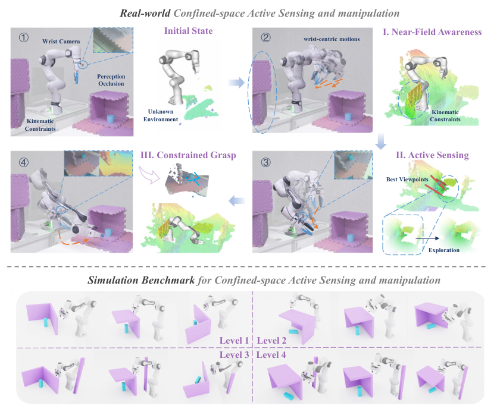
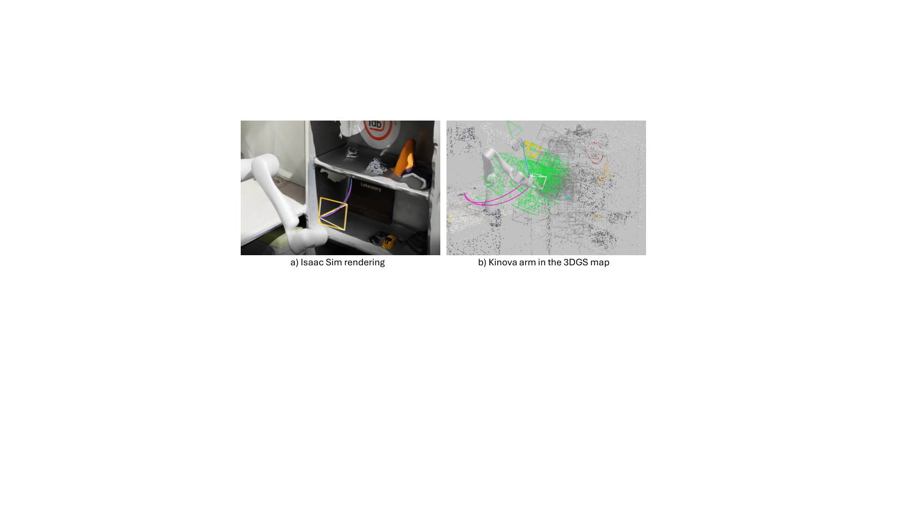
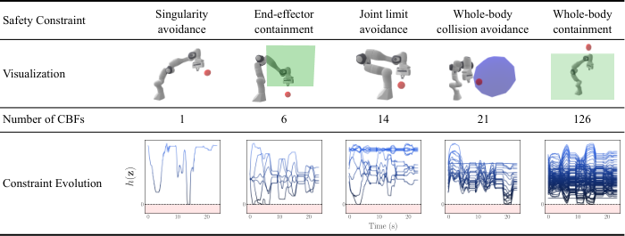
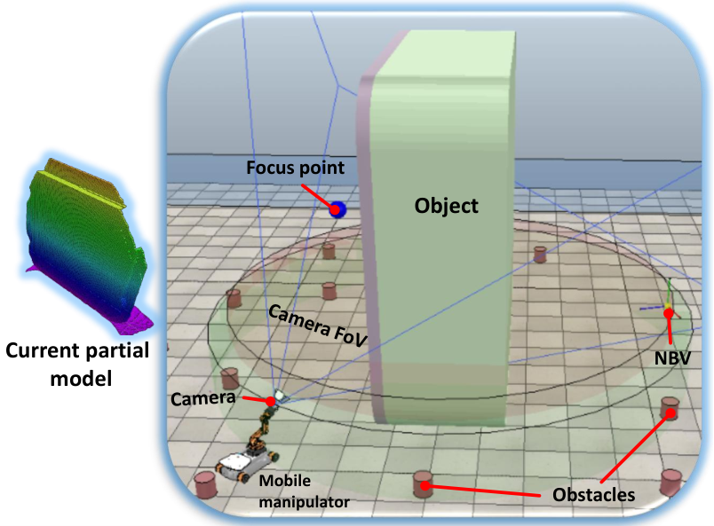
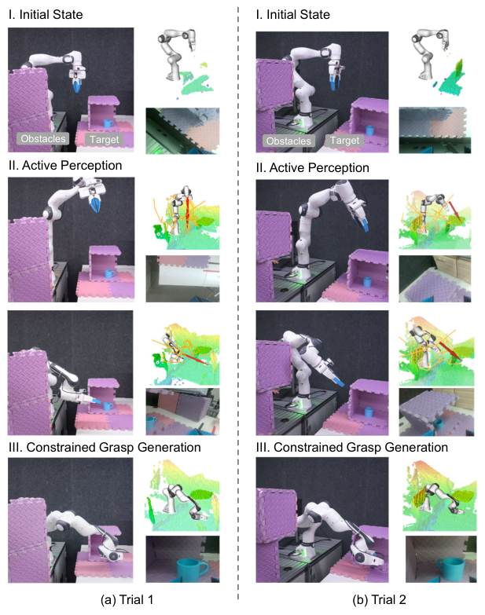

# 从信息收益，到可执行的视角

<section id="problem" class="report-section">

01 / PROBLEM · 问题的提出<h2>信息最优的方向，机器人走不动</h2>
地图认为继续沿某个方向移动能看到更多内容，UR5 却在执行过程中减速、停住。这不是某个单点 bug，而是信息决策与运动可执行性之间缺少一条链路。

本报告从一个具体的系统矛盾出发：OmniMap 的 Fisher 信息场给出“往哪看收益更大”的连续方向，info_flow/ 把它变成相机球面速率并交给 MoveIt Servo 执行；而 UR5 在执行途中反复减速甚至停住。只看相机轨迹，这个方向可能平滑而合理；放到机械臂上，同一段轨迹却可能要求腕部关节急剧转动，或者让下游 Servo 判定已接近奇异区域。因此，需要研究的对象不只是“下一个视角好不好”，还包括“从当前关节构型出发，机器人能否持续走向它”。

<strong>本报告要回答的核心问题：如何把“沿 Fisher 梯度请求相机移动”，改造成“从当前 UR5 构型出发，选择能执行、能产生有效新观测的短时信息动作”。</strong>

问题的几何根源是局部关系 <code>v_camera = J_camera(q) q̇</code>。当某个奇异值变小时，沿对应末端方向的速度需要更大的关节速度才能实现；这取决于期望运动的方向，并不意味着附近所有运动都不可执行。终点 IK 有解只能回答目标构型是否存在，不能回答沿途是否跳支、是否超速，以及当前速度命令能否实现。降低速度可以缓解瞬时需求，但不会自动改变通往危险构型的路线。换句话说，<b>终点有 IK 解、路径连续、沿途远离奇异构型，是三个不同的要求</b>——当前 Fisher 规划尚未显式预测这三项；独立运动学反馈、状态停车及执行侧可选 enforce 投影输出已实现，实机效果待验收。页首的二连杆演示直观展示了这种几何退化：拖动肘关节角，最小奇异值如何随构型趋于零。

用一次受限动作解释
向北的 Fisher 梯度更大，但腕部构型让下游持续减速；向东北的信息斜率略小，却能连续执行并取得新图像。我们需要验证的是：选择后者，是否带来更高的实际重建收益。只让 Python 发出更大的 Twist，不能回答这个问题。

<article class="insight">01<h3>运动学已经进入 NBV</h3>
COMPASS 将关节构型可操作度直接写入视角效用；Splat-CBF 把信息收益和连续安全约束结合。单独添加一个 manipulability reward，已有明确先例。
<a href="#papers">查看直接相关工作 ↗</a></article>
<article class="insight">02<h3>六轴需要重新定义任务</h3>
UR5 严格跟踪完整六维位姿时，通常没有可用关节零空间。释放光轴 roll、允许适量误差或提前改道，才有调整构型的空间。
<a href="#implementation">查看任务与接口设计 ↗</a></article>
<article class="insight">03<h3>关节反馈已接入，实机效果待验收</h3>
Planning 已接收 KinematicStatus，执行侧使用实际关节/Jacobian 并提供流式投影与停车。真机停机来源和标定效果仍需现场日志确认。
<a href="#current">查看代码证据 ↗</a></article>

沿着这个问题，报告按技术报告的顺序展开：先盘点当前三环链路与代码证据，确认“现状缺什么”；再检索并精读前沿工作，看各层缺口分别有哪些已验证的做法；然后给出针对本工作空间的改进方案——公式推导与落地修改分开陈述；最后设计对照实验，把收益归因到具体一环。

<nav class="reading-route" aria-label="报告章节路线"><a href="#current">02 / 现状分析代码链路与证据 ↗</a><a href="#papers">03–04 / 前沿算法论文地图与精读 ↗</a><a href="#method">05–06 / 改进方案公式推导与落地 ↗</a><a href="#validation">07 / 验证对照实验设计 ↗</a></nav>

证据边界
原调研完成论文检索；10-19 补充三环源码复盘与实验设计；10-21 新增连续梯度修正方案。未进行新的 UR5 真机验证，也未修改运动控制代码。资料来自 arXiv 原文及作者项目；项目未配置本地论文库，未覆盖个人 PDF 收藏。

</section>

<section id="current" class="report-section">

02 / SYSTEM STATUS · 源码复盘 2026.10.19<h2>现状分析：三环链路能做什么，看不见什么</h2>
以 info_flow/ 的 Tracking–Planning–Servo 为主线复盘源码。进程解耦的方向是对的；缺的是两条反馈，和一组被规划、任务定义与控制接口共享的运动学状态。

现有 Servo 已经读本机 TF 闭环控制，Planning 也会读更新的相机位姿。缺口是策略看不到下游为何限速/停止，也不区分“位姿消息仍在更新”和“新观测确实进入了地图”。进程分开降低了慢建图直接阻塞本机控制的风险；但动作效果与感知收益仍需影响下一次决策，这正是当前链路断开的地方。

<figure class="loop-figure">
<svg viewBox="0 0 960 300" role="img" aria-label="三环数据流：相机图像经 Tracking 入图，Planning 读相机位姿与 GS 快照计算球面速率，Servo 转成 Twist 交给 MoveIt Servo 与 UR5；UR5 运动产生新图像回到 Tracking。Servo 执行状态反馈与 Tracking 有效入图确认两条链路目前缺失。">
<defs>
<marker id="lf-arr" viewBox="0 0 10 10" refX="8" refY="5" markerWidth="7" markerHeight="7" orient="auto-start-reverse"><path d="M0 0L10 5L0 10z" fill="var(--accent)"/></marker>
<marker id="lf-arr-m" viewBox="0 0 10 10" refX="8" refY="5" markerWidth="7" markerHeight="7" orient="auto-start-reverse"><path d="M0 0L10 5L0 10z" fill="var(--amber)"/></marker>
</defs>
<path d="M605 128 C 560 56, 425 56, 380 124" fill="none" stroke="var(--amber)" stroke-width="2" stroke-dasharray="7 6" marker-end="url(#lf-arr-m)"/>
<path d="M125 128 C 160 80, 305 80, 350 124" fill="none" stroke="var(--amber)" stroke-width="2" stroke-dasharray="7 6" marker-end="url(#lf-arr-m)"/>
<text x="492" y="48" text-anchor="middle" font-size="12" fill="var(--amber)">执行状态反馈（缺失 · P1）</text>
<text x="237" y="72" text-anchor="middle" font-size="12" fill="var(--amber)">有效入图确认（缺失 · P1）</text>
<rect x="30" y="134" width="190" height="82" rx="12" fill="var(--accent-soft)" stroke="var(--line)"/>
<rect x="270" y="134" width="190" height="82" rx="12" fill="var(--accent-soft)" stroke="var(--line)"/>
<rect x="510" y="134" width="190" height="82" rx="12" fill="var(--accent-soft)" stroke="var(--line)"/>
<rect x="750" y="134" width="190" height="82" rx="12" fill="var(--surface2)" stroke="var(--line)"/>
<text x="125" y="162" text-anchor="middle" font-size="14" font-weight="650" fill="var(--ink)">Tracking</text>
<text x="125" y="184" text-anchor="middle" font-size="11" fill="var(--muted)">关键帧 → GS / TSDF 入图</text>
<text x="125" y="202" text-anchor="middle" font-size="11" fill="var(--muted)">pose 先于入图发布</text>
<text x="365" y="162" text-anchor="middle" font-size="14" font-weight="650" fill="var(--ink)">Planning</text>
<text x="365" y="184" text-anchor="middle" font-size="11" fill="var(--muted)">Fisher 梯度 → 球面速率</text>
<text x="365" y="202" text-anchor="middle" font-size="11" fill="var(--muted)">没有 q 与下游状态</text>
<text x="605" y="162" text-anchor="middle" font-size="14" font-weight="650" fill="var(--ink)">Servo</text>
<text x="605" y="184" text-anchor="middle" font-size="11" fill="var(--muted)">切向＋径向 PI · look-at</text>
<text x="605" y="202" text-anchor="middle" font-size="11" fill="var(--muted)">Twist @ 相机参考点</text>
<text x="845" y="162" text-anchor="middle" font-size="14" font-weight="650" fill="var(--ink)">MoveIt Servo · UR5</text>
<text x="845" y="184" text-anchor="middle" font-size="11" fill="var(--muted)">奇异性减速 / 停机</text>
<text x="845" y="202" text-anchor="middle" font-size="11" fill="var(--muted)">真实关节运动</text>
<line x1="220" y1="175" x2="264" y2="175" stroke="var(--accent)" stroke-width="2" marker-end="url(#lf-arr)"/>
<line x1="460" y1="175" x2="504" y2="175" stroke="var(--accent)" stroke-width="2" marker-end="url(#lf-arr)"/>
<line x1="700" y1="175" x2="744" y2="175" stroke="var(--accent)" stroke-width="2" marker-end="url(#lf-arr)"/>
<text x="242" y="128" text-anchor="middle" font-size="10" fill="var(--muted)">pose＋版本快照</text>
<text x="482" y="128" text-anchor="middle" font-size="10" fill="var(--muted)">SphericalCommand</text>
<text x="722" y="128" text-anchor="middle" font-size="10" fill="var(--muted)">delta_twist</text>
<path d="M845 216 L845 256 L125 256 L125 222" fill="none" stroke="var(--accent)" stroke-width="2" marker-end="url(#lf-arr)"/>
<text x="485" y="248" text-anchor="middle" font-size="11" fill="var(--muted)">真实运动 → 新相机图像 / TF（已有链路）</text>
</svg>
<figcaption>2026-10-21 的三环设计图。此后 KinematicStatus 已进入 Planning，快照 v4 已携带语义与几何的同帧编号；任务收益与实际运动进展的完整反馈仍待完善，对应<a href="#implementation">第 06 章</a>的 P1 交付。</figcaption></figure>

<table><thead><tr><th>三环</th><th>当前链路</th><th>缺口与改造方向</th></tr></thead><tbody>
<tr><td>Tracking 我知道了什么？</td><td>图像时间 TF → 关键帧 → OmniMap → 版本化 GS/TSDF/逐高斯语义快照 v4。pose 在入图前就发布。</td><td>快照已有 keyframe_idx 和语义 frame_idx；默认按当前实例 embedding 筛选高斯。新观测的任务收益仍未记录。</td></tr>
<tr><td>Planning 接下来做什么？</td><td>当前相机 pose＋GS 快照 → 局部 Fisher 梯度 → 两个球面速率；另接收 KinematicStatus 下游反馈。</td><td>已实现状态反馈；局部二维投影在执行侧可选 enforce，非零理想关节闭环通过，实机效果待验证。</td></tr>
<tr><td>Servo 实际上做到了什么？</td><td>本机 TF → 切向＋径向 PI＋完整 look-at → Twist → MoveIt Servo / UR。</td><td>已有命令追踪、状态与局部构型导数诊断；实际进展评估与连续改道控制仍需接入。</td></tr>
</tbody></table>

当前 StopMonitor 的路径/方向覆盖来自输入实际 pose，但 stall 用的是命令速度，检测不了“命令非零、机器人没动”；当前 YAML 的 stop 与 stall 开关均关闭。完成判据必须另行标定，不能把约束堵塞或预算耗尽当作信息收敛。同一地图在相机运动时可以复用；昂贵评分分频后仍需保持轻量命令发布与有效期检查。

<h3>四个可定位的代码风险</h3>
把这条链路具体到代码，可以定位四处断点：信息策略能生成相机运动，决策端已有运动学状态反馈，但尚未使用二维构型约束修正方向；执行端又固定了完整 look-at 姿态。添加任何评分项之前，首先需要确认实际配置和停机来源，再让规划、任务定义与控制接口共享同一组运动学状态。证据基于本轮检查的仓库快照，代码路径可在本地点击打开，行号对应报告生成时版本。

优先核对负角速度上限会关闭幅值限速01

<a href="../config/rtabmap_config.yaml">config/rtabmap_config.yaml:82</a> 中 <code>angular_speed_max: -0.05</code>。<a href="../info_flow/info_flow_servo_runtime.py">info_flow_servo_runtime.py:155–163</a> 的限幅函数在 <code>limit &lt;= 0</code> 时返回原向量。因此该值不会产生 0.05 rad/s 的角速度上限；角加速度斜率限制仍保留。
<pre><code>if norm &lt;= 1e-12 or limit &lt;= 0.0 or norm &lt;= limit:
    return vec, norm</code></pre>
已确认代码行为；尚未确认真机启动参数是否覆盖此值，也不能据此认定停机根因。

结构缺口规划器已有运动学状态反馈，连续构型修正待接入02

<a href="../info_flow/info_flow_planning_node.py">info_flow_planning_node.py</a> 订阅相机位姿、地图快照及 KinematicStatus；策略返回后按 observe/enforce 处理反馈。Planning 不加载 RobotModel，执行侧 monitor 计算 Jacobian 指标。执行端发布非零 Twist 的日志，也不能证明机器人在运动。

应同步采集 joint_states、实际速度、相机 TF、Servo 状态、UR 安全状态，以及地图版本。首先区分 MoveIt 奇异性停机、IK 跳支/无解与 UR protective stop。

任务约束执行端固定完整 look-at 姿态与 roll03

<a href="../info_flow/info_flow_servo_runtime.py">info_flow_servo_runtime.py:440</a> 每步重建 look-at 并跟踪完整 SO(3) 误差；<a href="../info_flow/servo_runtime_common.py">servo_runtime_common.py:219</a> 固定 up 向量为 [-1,0,0]。

这会限制 UR5 可用于调整构型的空间。光轴与 up 接近平行时，还可能发生相机基底退化或姿态跳变；它与机器人本身的 Jacobian 奇异性是不同问题。

仅更改规划器的 min-roll 选项，不能改变执行端独立重建的姿态。

约束范围FeasibilityProjector 仅约束相机几何范围04

<a href="../omnimap/gaussian/renderer/nbv/policy_improvements.py">policy_improvements.py:244</a> 约束仰角带及相机位置盒，没有检查机器人关节限位、IK 分支连续性、Jacobian 和碰撞；当前 YAML 中该功能也未启用。

<a href="../ros_ws/src/omnimap_msgs/msg/SphericalCommand.msg">SphericalCommand.msg</a> 只传球面运动等信息，没有 roll 目标、预测关节状态或运动学风险。扩展规划变量时需要同步调整接口和执行端。

为什么持续发布命令，机器人却不动？
已核对 <a href="https://github.com/moveit/moveit/blob/noetic-devel/moveit_ros/moveit_servo/src/servo_calcs.cpp">MoveIt Servo Noetic 源码</a>：控制器依据 Jacobian 条件数及运动方向缩放速度，接近危险区域时可进入 DECELERATE_FOR_SINGULARITY / HALT_FOR_SINGULARITY。需要实际状态消息才能确认你的停机是否属于这一类，不能通过提高阈值代替诊断。

<h3>已有实验并不支持把全局重定位放到第一步</h3>
<a href="eps_contrib_report.md">10-18 仿真报告</a>更正了“覆盖低是局部近视”的归因：约 46° 的实际路径已达到该报告估计方向覆盖上限的 78–90%；加大探测步长没有稳定质量收益。这支持先检查运动/时间预算，不能据此承诺更大的探测范围或全局跳转会更好。

还要先统一基线：旧报告写运行时使用 LogFisher，但当前 GSBackEnd 选择 LegacyFisher，当前仿真入口也走同一 backend。旧报告与当前代码的运行来源尚待核对，阈值不能直接沿用。已有仿真还使用单物体与部分 GT ROI，不能替代 UR5 真机或开放词汇语义验证。

完整复盘与源码依据
<a href="../ACTIVE_PERCEPTION_REVIEW.md">查看逐环证据、方法定义、反例检查、实施顺序与结果—主张边界 ↗</a>。下一章的论文材料是这些模块的设计来源，而非 UR5 效果证明。

</section>

<section id="papers" class="report-section">

03 / RELATED WORK · 论文地图<h2>前沿算法：从选视角，到连续执行</h2>
带着第 02 章的缺口检索文献。四篇重点工作分别补上“构型评分、途中感知、安全控制、任务自由度”；图卡用于快速定位，下一章展开问题、方法与实验结果。

文献检索分成四个连续的问题：<b>选视角时能否考虑构型质量？运动途中能否同时保留信息收益和安全裕度？安全控制具体怎样实现？对六轴 UR5，又有哪些相机约束其实可以放宽？</b>这四个问题与第 02 章的代码断点一一对应：Planning 看不到构型（问题一、二）、执行层如何修正命令（问题三）、执行端锁死完整姿态（问题四）。

<nav class="reading-route" aria-label="重点论文精读入口"><a href="#read-compass">01 / 选哪个视角COMPASS ↗</a><a href="#read-splat">02 / 途中如何观察Splat-CBF ↗</a><a href="#read-oscbf">03 / 怎样约束控制OSCBF ↗</a><a href="#read-reconstruction">04 / 释放哪些约束Reconstruction-Aware ↗</a></nav>

<article class="paper featured" data-tags="nbv hardware" data-search="COMPASS Li ICRA 2026 confined manipulation manipulability 可操作度 视角 效用" id="paper-compass">
<figure class="paper-figure"><figcaption>原论文 Fig. 1 · Li 等 · <a href="https://arxiv.org/html/2509.14787v2#S1.F1">图片出处 ↗</a></figcaption></figure>

NBV 效用ICRA 2026 · 已接收
<h3><a href="https://arxiv.org/abs/2509.14787">COMPASS</a></h3>
Confined-space Manipulation Planning with Active Sensing Strategy

Qixuan Li · Chen Le · Dongyue Huang · Jincheng Yu · Xinlei Chen

<b>核心突破</b> 让视角与关节构型一起参与选择，将信息增益、可操作度、任务引导和关节运动代价纳入 NBV 效用。

方法细节与适用边界

§IV-A2：候选状态 x=(v,q)，效用为 U(x)=wᵀ[G(x),D(x),M(x),H(x)]/C(x)。M(q)=√det(JJᵀ)，C 为关节空间轨迹长度。RRT 生成可达节点及无碰撞连接。

<b>证据：</b>Franka FR3 七轴机械臂＋腕部 D435i 真机实验。

<b>边界：</b>可操作度是软评分；未发现显式的全路径奇异性下界约束。它为“将 IK 性质纳入 NBV policy”提供直接先例。

<a href="https://arxiv.org/abs/2509.14787">论文 ↗</a><a href="https://arxiv.org/html/2509.14787v2#S4">方法原文 ↗</a>机械臂真机

</article>
<article class="paper featured" data-tags="nbv continuous safety" data-search="Splat-CBF Khass Cosse Motee 2026 Gaussian Fisher 信息 奇异性 barrier QP" id="paper-splat">
<figure class="paper-figure"><figcaption>原论文 Fig. 9 · Kinova <strong>仿真</strong> · <a href="https://arxiv.org/html/2609.23100v1#S5.F9">图片出处 ↗</a></figcaption></figure>

3DGS + CBF2026.09 · 预印本
<h3><a href="https://arxiv.org/abs/2609.23100">Splat-CBF</a></h3>
Safe Next-Best-View Control in 3D Gaussian-Splat Maps

Amirhossein Mollaei Khass · Athanasios Cosse · Nader Motee

<b>核心突破</b> 在统一 CBF-QP 中融合硬安全约束与软感知目标；机械臂实验明确加入奇异性、关节限位及碰撞 barrier。

方法细节与适用边界

§V-E：Random / COVER / FisherRF 选择 NBV，名义 operational-space 控制器生成关节速度。Safety Only 已包含奇异性等约束；Splat-CBF 再加入感知 barrier，利用冗余运动采集信息。

<b>证据：</b>机械臂是 Isaac Sim 中的七轴 Kinova Gen3；论文真机验证采用 Ackermann 移动机器人。

<b>边界：</b>未证明 UR5 真机效果。机械臂实验 QP 中位耗时约 1 ms，但 Fisher 感知梯度更新约 0.5–1.5 s，需要区分两者频率。

<a href="https://arxiv.org/abs/2609.23100">论文 ↗</a><a href="https://arxiv.org/html/2609.23100v1#S5.SS5">机械臂实验 ↗</a>机械臂仿真

</article>
<article class="paper" data-tags="continuous safety hardware" data-search="OSCBF Morton Pavone IROS 2025 operational space CBF 奇异性 安全 速度" id="paper-oscbf">
<figure class="paper-figure"><figcaption>原论文 Fig. 1 · Morton &amp; Pavone · <a href="https://arxiv.org/html/2503.06736v3#S0.F1">图片出处 ↗</a></figcaption></figure>

连续安全控制IROS 2025
<h3><a href="https://arxiv.org/abs/2503.06736">OSCBF</a></h3>
Safe, Task-Consistent Manipulation with Operational Space Control Barrier Functions

Daniel Morton · Marco Pavone

<b>核心突破</b> 用操作空间任务一致性目标减少安全修正对任务的影响；奇异性被写成约束，提供关节速度级和力矩级两种 QP。

方法细节与适用边界

公式 43–44：h(q)=μ(q)−ε，μ(q)=∏σᵢ(J)。§IV-B 的 Kinematic-OSCBF 适合参考现有速度接口；§IV-C 提供动态力矩形式。

<b>证据：</b>Panda 真机力矩控制实验。作者提供公开代码及机器人适配入口。

<b>边界：</b>不负责选择 NBV；六轴完整位姿任务可能因安全约束而偏离或停止。输入限制、约束冲突和松弛会影响安全保证，不能直接宣称无条件安全。

<a href="https://arxiv.org/abs/2503.06736">论文 ↗</a><a href="https://github.com/StanfordASL/oscbf">代码 ↗</a><a href="https://stanfordasl.github.io/oscbf/">项目 ↗</a>机械臂真机

</article>
<article class="paper" data-tags="nbv continuous hardware" data-search="Object Reconstruction Aware Whole body Control Dursun Adorno Watson Pan T-RO 2026 roll 光轴 连续重建" id="paper-reconstruction">
<figure class="paper-figure"><figcaption>原论文 Fig. 1 · Dursun 等 · <a href="https://arxiv.org/html/2509.04094v3#S1.F1">图片出处 ↗</a></figcaption></figure>

连续重建 / 自由 rollT-RO 2026
<h3><a href="https://arxiv.org/abs/2509.04094">Reconstruction-Aware Control</a></h3>
Object-Reconstruction-Aware Whole-body Control of Mobile Manipulators

Fatih Dursun · Bruno Vilhena Adorno · Simon Watson · Wei Pan

<b>核心突破</b> 前往 NBV 时持续看向有用的 focus point；只约束相机位置与指向，释放 roll 自由度。

方法细节与适用边界

通过连续运动学 QP、软可见性约束和避障约束增强途中重建。论文明确讨论 roll 对 FoV 覆盖体积影响较小，因此不跟踪完整姿态。

<b>证据：</b>ShapeNet 仿真，以及移动机械臂和腿式机械臂实验；T-RO 42 (2026), 2912–2930。

<b>边界：</b>NBV 终点仍从 200 个离散候选中选择；工作重点是 NBV 之间的连续观察，没有直接证明 UR5 奇异性规避。实际 roll 会影响矩形视野与遮挡。

<a href="https://arxiv.org/abs/2509.04094">论文 ↗</a><a href="https://github.com/fthdrsn/NBV_object_recontruction">代码 ↗</a>机械臂真机

</article>
<article class="paper compact" data-tags="continuous safety hardware" data-search="NEO Haviland Corke RA-L 2021 manipulability reactive QP 可操作度">

反应式 QPRA-L 2021
<h3><a href="https://arxiv.org/abs/2010.08686">NEO</a></h3>
A Novel Expeditious Optimisation Algorithm for Reactive Motion Control of Manipulators

Jesse Haviland · Peter Corke

<b>核心突破</b> 在实时 QP 中融合可操作度最大化、碰撞规避、关节约束及任务松弛。

借鉴点与边界

适合作为连续控制实现参考，有机械臂真机验证；没有主动视觉信息目标。将其用于 UR5 时，需要明确哪些相机任务可以松弛。

<a href="https://arxiv.org/abs/2010.08686">论文 ↗</a>机械臂真机

</article>
<article class="paper compact" data-tags="safety hardware" data-search="Fast Manipulability Maximization Continuous-Time Trajectory Optimization Maric IROS 2019 轨迹">

轨迹优化IROS 2019
<h3><a href="https://arxiv.org/abs/1908.02963">沿整条轨迹优化可操作度</a></h3>
Fast Manipulability Maximization Using Continuous-Time Trajectory Optimization

Filip Marić · Oliver Limoyo · Luka Petrović · Trevor Ablett · Ivan Petrović · Jonathan Kelly

<b>核心突破</b> 用连续时间高斯过程表示关节轨迹，在轨迹优化中提升可操作度，超越只检查终点。

借鉴点与边界

支持将关节构型质量评估扩展到 NBV 运动全过程，有仿真与机械臂实验。它不包含主动视觉目标，软可操作度优化也不等于严格奇异性约束。本轮核对范围为摘要与书目信息。

<a href="https://arxiv.org/abs/1908.02963">论文 ↗</a>机械臂实验

</article>
<article class="paper compact" data-tags="nbv continuous hardware" data-search="Closed Loop Next Best View Planning Target Driven Grasping Breyer Ott Siegwart Chung 2022 IK 过滤">

终点 IK 基线2022 · arXiv
<h3><a href="https://arxiv.org/abs/2207.10543">Closed-Loop NBV for Grasping</a></h3>
Closed-Loop Next-Best-View Planning for Target-Driven Grasping

Michel Breyer · Lionel Ott · Roland Siegwart · Jen Jen Chung

<b>核心突破</b> 通过 IK 排除不可达 NBV，低频闭环重规划与更高频的笛卡尔速度伺服分开运行。

借鉴点与边界

Panda＋D435 实验；可作为 OmniMap 增加“终点 IK 过滤”的基线。候选计算仅考虑运动学可达性，不能等同于路径无碰撞或远离奇异点。

<a href="https://arxiv.org/abs/2207.10543">论文 ↗</a><a href="https://github.com/ethz-asl/active_grasp">代码 ↗</a>机械臂真机

</article>
<article class="paper compact" data-tags="continuous safety hardware" data-search="Real Time Model Predictive Control Industrial Manipulators Singularity Tolerant Hierarchical Task Lee Seo Bylard Sun Sentis ICRA 2023 工业 六轴 MPC">

工业臂 / MPCICRA 2023
<h3><a href="https://arxiv.org/abs/2209.11880">Singularity-Tolerant MPC</a></h3>
Real-Time Model Predictive Control for Industrial Manipulators with Singularity-Tolerant Hierarchical Task Control

Jaemin Lee · Mingyo Seo · Andrew Bylard · Robert Sun · Luis Sentis

<b>核心突破</b> 通过奇异性容忍的分层控制与短时 MPC，处理工业臂接近腕部奇异构型时的平滑运动问题。

借鉴点与边界

采用截断小奇异值的 SVD 与轨迹线性化 QP MPC。Kawasaki RS020N 真机通过厂商关节位置接口执行生成轨迹；不是直接在真机上施加力矩控制。

更接近六轴工业机械臂的接口限制，但不包含主动视觉，也未发现显式的最小奇异值硬下界。

<a href="https://arxiv.org/abs/2209.11880">论文 ↗</a>工业臂真机

</article>

没有匹配的论文。试试 “roll”“QP”“NBV”，或切回全部。

与你已读的 GauSS-MI 的关系
<a href="https://arxiv.org/abs/2504.21067">GauSS-MI（Xie 等，RSS 2025）</a>提供高斯表示下的信息收益目标，真实平台为 Panda。使用 MoveIt 规划与控制，不应直接理解为已经优化奇异性裕度。本次检索补充的是视角的关节构型质量、沿途可执行性和连续执行约束。

</section>

<section id="reading" class="report-section">

04 / RELATED WORK · 论文精读<h2>四篇重点论文，补齐同一条执行链</h2>
它们并非四个可以直接替换的 NBV 算法，而是在不同层面回答问题。以下结果均标明平台与比较对象，避免把七轴或移动机器人的结论直接套到 UR5。

<article id="read-compass" class="paper-study">

01<small>VIEW + CONFIGURATION</small>

COMPASS · ICRA 2026 已接收 · FR3 真机
<h3>先回答：信息最多的视角，是否也方便机器人到达？</h3>
最值得借鉴的是把候选从“相机视角”提升为“视角＋关节构型”，让运动学真正参与上游决策。

<h4>它针对什么问题</h4>
在狭窄容器中寻找并抓取目标时，遮挡要求机器人不断换视角，有限的活动空间又约束机械臂运动。单纯贪心选择信息增益最高的位置，可能把机器人带到难以到达、难以继续移动或不利于抓取的构型。COMPASS 因而将主动感知与后续操作连起来考虑。

<h4>它提出了什么方法</h4>
系统先做近场扫描以建立周边环境，再用 MUE-RRT 探索，最后执行受约束的抓取优化。探索节点写成 <code>x=(v,q)</code>，同时包含视角和关节构型；RRT 搜索可达节点并建立无碰撞连接。节点效用把未知体积收益 G、运动惯性项 D、可操作度 M 和任务启发 H 加权，再除以关节空间轨迹长度 C。这里的 <code>M(q)=√det(JJᵀ)</code> 让信息相近但构型质量不同的视角获得不同评分。

这比在 NBV 选完之后才调用 IK 更进一步：机器人姿态的好坏会直接改变“下一步想去哪里”。但可操作度仍是效用中的一项，可能与信息收益或代价发生权衡，并不是不可违反的安全条件。

<h4>实验达到了什么效果</h4>
<table class="study-table"><caption>仿真最困难的 Level 4，原文 Table II</caption><thead><tr><th>指标</th><th>IG</th><th>GSE</th><th>COMPASS</th></tr></thead><tbody><tr><td>整体任务成功率 ↑</td><td>25.0%</td><td>45.0%</td><td>62.5%</td></tr><tr><td>平均可操作度 ↑</td><td>0.058</td><td>0.059</td><td>0.066</td></tr></tbody></table>

表 II 四个难度的整体成功率取算术平均，COMPASS 比 IG 高 <b>39.25 个百分点</b>，比 GSE 高 <b>24.25 个百分点</b>。FR3 七轴机械臂搭配腕部 D435i 的真机实验中，每种场景进行 10 次试验，报告整体成功率平均为 80%，平均找到目标用时 159.75 s。这支持“把感知与运动规划结合，有助于受限空间任务完成”的结论。

<h4>对 UR5 能带走什么，不能据此推出什么</h4>
建议先读它的效用定义与探索节点表示，用于构建 OmniMap 的“构型感知 NBV”基线：同一视角评估从当前构型可连续到达的 IK 解，并计入运动代价与构型质量。上述成功率来自整套流程，<b>不能归因于可操作度项的单独作用</b>；原文也没有给出全路径最小奇异值的硬下界。FR3 的七轴冗余与 UR5 的六轴结构不同，不能直接复用构型调整策略。

<a href="https://arxiv.org/html/2509.14787v2#S4">精读 §IV：方法 ↗</a><a href="https://arxiv.org/html/2509.14787v2#S6.T2">Table II：仿真 ↗</a><a href="https://arxiv.org/html/2509.14787v2#S6.SS2">§VI-B：真机 ↗</a>

构型评分让策略更少选到难执行的目标，但即使终点合适，途中仍可能遇到信息与安全的冲突。这引出第二篇工作。

</article>
<article id="read-splat" class="paper-study">

02<small>INFORMATIVE EXECUTION</small>

Splat-CBF · 2026.09 预印本 · Kinova 仿真
<h3>再回答：去往 NBV 的过程中，能否一边观察、一边满足安全约束？</h3>
它与 OmniMap 的表示最接近：在在线 3DGS 地图上，把连续感知收益接入执行层的约束优化。

<h4>它针对什么问题</h4>
NBV 给出希望到达的相机位置后，常规安全过滤器可能只负责绕开障碍；运动途中的相机朝向和观测质量未必理想。另一方面，如果持续追求信息收益，又可能把机器人拉向危险区域。Splat-CBF 研究的正是这两个目标在连续运动时如何协调。

<h4>它提出了什么方法</h4>
论文从高斯地图构建风险感知的环境安全 barrier，并用预期 Fisher 信息构造软感知 barrier，再把两者放进同一个 CBF-QP。可把它理解为：名义控制器提出“想怎么走”，硬安全条件限制可选速度，软感知条件在剩余空间内争取有用观测；发生冲突时，自适应松弛使安全优先。与终点的单次信息评分相比，感知目标会影响途中实际执行的运动。

机械臂实验在 Isaac Sim 中使用七轴 Kinova Gen3 和腕部 RGB-D，相同的 Random、COVER 或 FisherRF 选择器分别搭配 Safety Only 与 Splat-CBF。关键是：<b>两个执行器都已有自碰撞、关节限位和奇异性 barrier</b>，后者新增的是软感知约束。这组对照检验的是安全运动中的信息利用，而不是“有没有奇异性保护”。

<h4>实验达到了什么效果</h4>
<table class="study-table"><caption>固定 COVER 视角选择器，原文 Table III</caption><thead><tr><th>指标</th><th>Safety Only</th><th>Splat-CBF</th></tr></thead><tbody><tr><td>PSNR ↑</td><td>17.08 dB</td><td>17.96 dB</td></tr><tr><td>SSIM ↑</td><td>0.712</td><td>0.737</td></tr><tr><td>深度 RMSE ↓</td><td>0.376 m</td><td>0.355 m</td></tr><tr><td>QP 求解中位耗时 ↓</td><td>0.91 ms</td><td>1.15 ms</td></tr></tbody></table>

另外两种选择器也得到方向一致的重建指标改善，但幅度不同：Random 的 PSNR 为 15.78 → 16.85 dB，FisherRF 为 16.69 → 16.87 dB。作者报告机械臂试验均无碰撞、环境安全裕度保持为正。这说明在相同观测预算下，执行层的途中感知约束可以改善最终地图；它没有提供专门隔离奇异性规避效果的消融。

<h4>对 UR5 能带走什么，不能据此推出什么</h4>
值得借鉴的是“信息目标与运动学约束分层、共同作用于实际关节速度”的结构。需要特别注意计算口径：约 1 ms 只是约束构建后的 QP 求解；包含高斯集合构建和有限差分 Fisher 感知梯度的完整过滤更新约为 <b>0.5–1.5 s</b>。OmniMap 因而更适合低频更新信息方向、高频维护运动学安全。论文的机械臂结果是仿真，真机平台是 Ackermann 移动机器人，尚不能证明 UR5 上同样有效。

<a href="https://arxiv.org/html/2609.23100v1#S4">精读 §IV：控制设计 ↗</a><a href="https://arxiv.org/html/2609.23100v1#S5.SS5">§V-E：机械臂实验 ↗</a><a href="https://arxiv.org/html/2609.23100v1#S5.T3">Table III：完整结果 ↗</a>

Splat-CBF 给出了信息与安全的组合方式，而机械臂的奇异性 barrier 来自操作空间控制框架。要把这一层接到 UR5，需要继续读 OSCBF。

</article>
<article id="read-oscbf" class="paper-study">

03<small>TASK-CONSISTENT SAFETY</small>

OSCBF · IROS 2025 · Panda 真机 · 开源
<h3>第三个问题：保护机器人时，怎样尽量保留相机任务？</h3>
这是四篇中最值得对照代码读的控制论文：它把奇异性写成安全约束，并明确区分关节速度与力矩接口。

<h4>它针对什么问题</h4>
安全过滤器不仅要阻止危险运动，还要决定如何修改命令。如果只在关节空间寻找最接近原命令的安全解，微小的关节修正也可能明显改变末端任务；如果只关心末端误差，又可能产生不必要的零空间运动。OSCBF 希望安全干预在操作空间中保留主任务，并合理处理次级姿态任务。

<h4>它提出了什么方法</h4>
作者在 QP 中使用与操作空间控制一致的目标度量，把末端任务与零空间任务的偏离分别纳入优化，同时施加关节、工作空间、碰撞和奇异性条件。奇异性示例定义 <code>h(q)=μ(q)−ε</code>，其中 <code>μ(q)=∏σᵢ(J)</code>。在速度控制下，要求 h 的变化不能让系统过快接近安全边界；因此控制器可以提前削弱或改变使构型进一步恶化的速度分量。

原文 §IV-B 给出 Kinematic-OSCBF 关节速度 QP，§IV-C 给出动态力矩版本。对于现有速度指令链，前者是更直接的起点；论文 Panda 硬件演示采用力矩控制，不能把那套接口当作 UR5 已具备的能力。

<h4>实验达到了什么效果</h4>
在七轴 Panda 仿真中，作者同时激活 168 个 CBF 条件，向机器人发送会接近各类安全边界的末端指令。报告中各 barrier 均未进入负值区域，并保留任务跟踪。原文 Table II 给出的计算频率如下；这是作者平台的计算基准，并非 UR5 的实测闭环频率。

<table class="study-table"><caption>168 个约束同时启用，原文 Table II</caption><thead><tr><th>计算频率</th><th>速度控制</th><th>力矩控制</th></tr></thead><tbody><tr><td>平均</td><td>3.24 kHz</td><td>2.94 kHz</td></tr><tr><td>第 5 百分位</td><td>2.35 kHz</td><td>2.25 kHz</td></tr></tbody></table>

真机使用 1 kHz Panda 力矩接口，在四项实验中展示安全边界附近的平滑跟踪、全身避碰和近奇异构型运动。论文报告部分位置安全边界的接近距离达到 6 mm，近奇异实验使用 μ=10⁻²。这些实验说明控制器具有实际运行和快速修正能力；该 μ 数值依赖机器人、Jacobian 定义和尺度，不能作为 UR5 的通用阈值。

<h4>对 UR5 能带走什么，不能据此推出什么</h4>
优先查看开源实现中的速度 QP、奇异性函数和机器人模型适配。落地时应使用相机任务对应的 Jacobian，并检查实际执行的关节速度是否与优化结果一致。最重要的边界是：<b>安全过滤器不负责找到新 NBV，也不保证一定继续前进</b>。若完整六维任务与安全条件冲突，结果仍可能是偏离任务或停住；输入限制、离散控制和约束不可行也需要单独处理。要减少停滞，上游必须接收受限信息并改变策略。

<a href="https://arxiv.org/html/2503.06736v3#S4">精读 §IV：两种控制接口 ↗</a><a href="https://arxiv.org/html/2503.06736v3#S5">§V：仿真与硬件 ↗</a><a href="https://github.com/StanfordASL/oscbf">作者代码 ↗</a>

对七轴机械臂，冗余关节为安全修正提供空间；对严格跟踪六维位姿的六轴 UR5，这个空间通常不存在。于是最后一个问题是：相机真的需要锁死全部姿态吗？

</article>
<article id="read-reconstruction" class="paper-study">

04<small>WHAT THE CAMERA NEEDS</small>

Object-Reconstruction-Aware Whole-body Control · T-RO 2026 · 开源
<h3>最后回到任务本身：控制位置与指向，是否就够了？</h3>
它的启发不只是让机器人“边走边看”，还在于把相机需要满足的任务与人为固定的完整姿态分开。

<h4>它针对什么问题</h4>
只在 NBV 终点拍照，会浪费转场期间的观测机会；但为了寻找有信息的路径而反复采样和评分，又会增加计算负担。这篇工作希望在不过度增加路径搜索的前提下，让两次 NBV 之间的运动持续服务于重建。

<h4>它提出了什么方法</h4>
系统仍从 200 个离散候选中选择 NBV，但额外在未知区域计算一个有信息的 focus point。移动过程中，连续运动学 QP 通过软可见性约束尽量把这个点留在视野中，并结合避障与绕障约束；接近 NBV 时，逐渐降低该辅助约束的权重，优先到达终点。其关键是用一个有意义的凝视目标代替反复评价大量途中候选。

主任务使用相机位置与单位光轴方向。方向向量虽有三个分量，独立自由度只有两个，因此任务局部为 <b>3D 位置＋2D 指向</b>，不要求跟踪光轴 roll。对六轴机械臂，这在任务 Jacobian 满行秩时通常可以释放一个局部自由度；它有利于构型调整，但仍需明确地把该自由度用于改善运动学。

<h4>实验达到了什么效果</h4>
<table class="study-table"><caption>114 个 ShapeNet 对象，第 10 个 NBV，原文 Table II 均值</caption><thead><tr><th>指标</th><th>Focus</th><th>路径采样</th><th>No path</th></tr></thead><tbody><tr><td>物体覆盖率 ↑</td><td>83.3%</td><td>84.0%</td><td>79.4%</td></tr><tr><td>途中信息规划累计计算时间 ↓</td><td>11.70 s</td><td>203.61 s</td><td>—</td></tr><tr><td>累计计算＋运动时间 ↓</td><td>600.46 s</td><td>833.42 s</td><td>555.37 s</td></tr></tbody></table>

在这项配置下，Focus 比路径采样少用约 17.4 倍的途中规划计算时间，总时间减少 27.9%，覆盖率低 0.7 个百分点；相对 No path，则用更长时间换来高 3.9 个百分点的覆盖率。随视场和地图分辨率变化，论文报告计算加速范围为 <b>6.2–19.36 倍</b>。因此它展示的是效率与重建收益之间的折中，不能把“计算快十几倍”写成“机器人运动快十几倍”。论文另有八自由度移动机械臂及腿式机械臂真机验证。

<h4>对 UR5 能带走什么，不能据此推出什么</h4>
应优先借鉴位置＋指向的任务表示，以及途中信息目标的软约束设计。OmniMap 可以检验：允许 roll 随构型调整，是否在保留目标可见性的同时减少奇异性停机。但论文没有直接加入 UR5 奇异性约束，也没有通过 roll 消融证明停机减少。矩形视野、遮挡和相机安装都会使 roll 影响观测收益，仍需在实际重建指标中验证。

<a href="https://arxiv.org/html/2509.04094v3#S4">精读 §IV：任务与 QP ↗</a><a href="https://arxiv.org/html/2509.04094v3#S5.T2">Table II：重建与时间 ↗</a><a href="https://arxiv.org/html/2509.04094v3#S5.T3">Table III：参数变化 ↗</a><a href="https://github.com/fthdrsn/NBV_object_recontruction">作者代码 ↗</a>

</article>

WHAT THESE PAPERS JOINTLY TELL US<h3>值得组合的是四种能力，而非把一篇论文整体搬到 UR5。</h3>

COMPASS 让决策知道构型好坏；Splat-CBF 让执行途中继续获取信息；OSCBF 提供连续安全修正的具体机制；重建感知控制则提醒我们重新定义相机任务。将它们连起来，合理的系统应当在选方向时预判运动学，在执行时维护约束，并把受限结果反馈给规划器。

这也说明研究贡献不能只表述为“给 NBV 加可操作度奖励”或“把 Fisher 信息与 CBF 结合”，这些已有直接先例。更值得检验的问题是：在六轴、在线地图、有限控制接口的实际条件下，联合调整视角与 roll、评估短时关节轨迹、反馈真实执行状态，能否同时减少停滞并提高单位时间重建收益。这里提出的是待验证方向，尚未完成针对该组合的独立查新或实验论证。接下来两章把这组能力具体化：<a href="#method">第 05 章</a>给出算法与公式推导，<a href="#implementation">第 06 章</a>给出落地修改建议。

</section>

<section id="method" class="report-section">

05 / PROPOSED METHOD · 公式与算法 · 2026.10.21<h2>改进方案 I：让信息梯度，沿机械臂能走的方向前进</h2>
优先验证方案：连续梯度修正——保留 Fisher 信息方向，只在构型恶化过快时加入最小修正；离散 NBV 采样降级为停滞恢复手段。局部速度映射、方向导数及执行侧可选 enforce 已实现并通过非零理想关节闭环，尚未完成真实 UR5 标定与运动验收。

<strong>设计原则：不替换信息目标，只约束它的实现方式。</strong>无需每 tick 采样多个视点、渲染和求 IK。终点 IK 采样是有价值的基线，但不检查整条到达路径；短时 rollout 保留为模型失配时的后续比较。方案分四步：①选一个反映“最薄弱方向”的构型指标 m(q)；②把它的改善方向拉回 Planning 实际的二维动作空间，用一条半空间约束做最小修正；③全程只需少量方向导数，不需要完整六维梯度；④明确闭式修正的失效条件与升级为小型 QP 的路径。

当前 q 与执行规则 <b>本机运动学模型</b><i>→</i>归一化 Jacobian <b>m 与方向导数 a</b><i>→</i>Fisher 信息运动 <b>二维最小修正</b><i>→</i>Servo 执行反馈 <b>下一 tick 重算</b>

流程对应可编辑的 <a href="assets/ur5_nbv/gradient-planning.drawio">draw.io 源文件</a>。下方两个演示均为合成教学数据，不代表 UR5 仿真或真机结果。

<h3>① 构型指标 m(q)：看最薄弱方向，而不是总体积</h3>

推荐 <strong>m(q) = σmin(J̄(q))</strong>。它衡量最弱方向的局部运动能力，不是到奇异点的几何距离。可操作度乘积可能被其他大奇异值补偿；条件数反映强弱比例；最小奇异值更直接对应薄弱方向。

先统一量纲：<code>J̄ = Dₓ⁻¹ J_tool0 Dq</code>。Dₓ = diag(v_ref × 3, ω_ref × 3)，Dq = diag(各关节参考速度)。它们使用固定任务尺度，且 Jacobian 与速度采用同一坐标系、同一 tool0 参考点；二范数指标不能替代逐关节速度限制。当前实现先按与 Servo 一致的完整 6D tool0 任务评估，若改 5D，必须同步执行端和指标定义。

<h3>② 把关节构型改善方向，变成两个球面速率的最小修正</h3>

令 u = (θ̇, φ̇)，由执行端相同的切向、look-at 与径向规则建立局部模型 <code>q̇ ≈ A(q)u + b(q)</code>。A 的两列表示两种球面运动引起的关节速度，b 是径向和姿态纠偏。可由任务 Jacobian 的阻尼逆求近似映射；接近奇异时必须检查预测残差，不能把阻尼逆当精确逆。

将构型梯度拉回动作空间：<strong>a = Aᵀ∇m</strong>。先把两个球面速率按固定参考速率缩放到无量纲坐标，下面的欧氏距离与向量图均在该坐标中定义，A 也应相应变换。设 h = m − m_min，要求 m 不要恶化过快：

<h3>只补上必要的改善分量</h3>
α &gt; 0，单位 s⁻¹；阈值需按本机日志标定。右图采用 b = 0、‖a‖ = 1 的教学特例。

aᵀu ≥ c，c = −αh − ∇mᵀb

min ½‖u − u_info‖²，满足 aᵀu ≥ c

u* = u_info + max(0, c − aᵀu_info) a / ‖a‖²
<small>单个半空间、无其他约束且 ‖a‖ &gt; 0 时的闭式解。</small>

<h3>公式怎样一步步得到</h3>
从相机任务速度与关节速度的局部关系开始：<code>v_task = J_task(q) q̇</code>。两个球面速率组成 <code>u = [θ̇, φ̇]ᵀ</code>，执行端的切向、径向和姿态规则给出 <code>q̇ ≈ A(q)u + b(q)</code>。因此构型质量的瞬时变化为：

<b>ṁ</b> = ∇qm(q)Tq̇

= ∇qmT(Au + b)

= <b>(AT∇qm)T</b>u + ∇qmTb

令 <b>a = AT∇qm</b>，就得到 <code>ṁ = aᵀu + ∇mᵀb</code>。

安全裕度定义为 <code>h = m − m_min</code>。要求它满足 <code>ḣ ≥ −αh</code>，表示远离阈值时允许缓慢下降，接近阈值时必须减小下降速度。代入上式：

<code>aᵀu + ∇mᵀb ≥ −αh</code>，所以 <b>c = −αh − ∇mTb</b>，最终得到 <b>aᵀu ≥ c</b>。

若原始信息动作 <code>u_info</code> 已满足约束，保留它；若不满足，则沿约束法向量 <code>a</code> 推到边界。令 <code>u* = u_info + λa</code>，令边界等式成立可得 <code>λ = (c − aᵀu_info)/‖a‖²</code>，再用 <code>max(0, λ)</code> 保证不对可行动作做多余修正。

这里的 <code>A</code> 是动作空间到关节速度的局部映射，<code>a</code> 不是 MoveIt 发布的变量；它现由执行侧 monitor 使用同一 RobotModel、实际 Servo 速度映射和 TF/桥接规则计算，随独立 KinematicConstraint 发布；Planning 尚未将它用于控制。

<h3>③ 实时计算：只求两个方向导数，不必求完整六维梯度</h3>

真正用到的是 a 的两个分量。冻结当前 A，对每一列直接中心差分：<code>aᵢ ≈ [m(q + δᵢAᵢ) − m(q − δᵢAᵢ)] / (2δᵢ)</code>。按关节扰动范数选择 δᵢ，并用不同步长检查稳定性；Aᵢ 接近零时不能再除以其范数。需估计 ∇mᵀb 时，再沿 b 做一次中心差分。

1 + 4
当前值一次＋两个方向各两次 Jacobian / 小型 SVD

+ 2
b 非零且需数值求导时 额外两次运动学计算

0 <small>次</small>
此修正步骤新增的候选渲染 与迭代 IK 调用

缓存 URDF、相机外参和运动学模型，在进程内计算，避免每次求导调用 ROS 服务。以上是评估次数，不是耗时承诺；构建 A、读状态与通信也有成本。若目标为 30 Hz，周期约 33 ms，应分别测总 tick 与运动学修正的 P50 / P95 / P99 耗时及状态年龄，再决定更新频率；昂贵 Fisher 更新与轻量运动学修正可以分频。

<h3>④ 边界与升级路径：什么时候闭式修正不够用</h3>

失效条件清单

最弱奇异值切换时可能不可微，精确奇异处也可能缺少有效逃逸梯度。‖a‖ 接近零且约束不满足，表示当前动作空间没有有效修正方向，应触发停滞恢复，不能靠给分母加小常数宣称约束仍成立。

加入关节速度、加速度和其他约束后，应联合求小型 QP；先闭式修正再逐项裁剪可能破坏原约束。低频 Planning 的近似模型不构成执行层安全证明，仍需保留 Servo 保护，并对齐实际 q̇ 与模型残差。

m_min 通过实际日志与下游减速状态标定；另行监控 MoveIt 所用 Jacobian 的条件数。当前 tool0 归一化指标与下游原始指标不一致，不能共用阈值。释放 roll 也必须修改执行端，六轴 UR5 完整 6D 满秩任务没有可供直接叠加的关节零空间。

ESCALATION / 执行层约束形式<h3>把信息运动作为目标，把奇异性作为约束</h3>
若证据表明闭式修正不足，再升级为执行处的关节速度 QP。Jtask 是所选相机任务的局部 Jacobian；vinfo 为信息策略期望的任务速度。五维任务使用位置和光轴指向的独立局部坐标。

minq̇ &nbsp; ‖Jtask(q)q̇ − vinfo‖²W + λ‖q̇‖²

∇h(q)ᵀq̇ ≥ −αh(q)

h(q) = m(q) − mmin
<small>并施加关节位置、速度及碰撞约束。</small>

这是局部控制设计，不是无条件安全保证。需处理输入/加速度限制、采样延迟与 QP 不可行；若下游 MoveIt Servo 再次修改命令，必须核对实际执行的关节速度。可操作度乘积之外，应监控尺度归一化的最小奇异值；平移与转动量纲不能随意混用。

依据：<a href="https://arxiv.org/abs/2002.11901">Haviland &amp; Corke：可操作度优化与允许路径偏差</a>；<a href="https://arxiv.org/html/2503.06736v3#S4">Morton &amp; Pavone：OSCBF 约束过滤</a>；<a href="https://raw.githubusercontent.com/moveit/moveit/noetic-devel/moveit_ros/moveit_servo/src/servo_calcs.cpp">MoveIt Servo Noetic 源码</a>。二维动作空间映射和方向差分为本文针对 OmniMap 的组合推导。

</section>

<section id="implementation" class="report-section">

06 / PROPOSED METHOD · 落地修改<h2>改进方案 II：先补反馈，再接修正，再改接口</h2>
第 05 章的公式要变成代码，顺序很重要：没有正确基线和执行反馈，任何新策略的效果都无法归因。反馈、追踪、桥接 watchdog 与状态干预已实现并完成隔离测试；连续修正和真实运动效果仍待验证。

三环继续解耦：Tracking 提供可信的新证据，Planning 选择可执行的信息动作，Servo 保持本机闭环并报告真实效果。先保留现有 MoveIt Servo 执行路径，验证反馈能否支持策略改道；约束 QP 根据瓶颈证据另行评估。按下表的优先级推进，所有组共享 P0 的修正。

<table><thead><tr><th>优先级</th><th>交付内容</th><th>完成时应能回答</th></tr></thead><tbody>
<tr><td>P0 / 正确基线</td><td>核对生效限速、数据新鲜度、外参、Fisher evaluator 与实际耗时；所有组共享修正。</td><td>是配置/时序异常，还是动作本身受限？</td></tr>
<tr><td>P1 / 动作反馈</td><td>执行摘要进入 Planning；区分等待、约束堵塞、故障和信息完成。</td><td>请求移动后，机器人和地图各发生了什么？</td></tr>
<tr><td>P2 / 连续修正</td><td>归一化 σ_min → 二维方向差分 → 最小约束修正。</td><td>能否以更低计算量提前绕开减速区？采样与 rollout 作对照。</td></tr>
<tr><td>P3 / 任务放宽</td><td>自由 roll 同时进入评分相机、规划消息和执行任务；QP 按证据另行设计。</td><td>改善是否确实来自释放姿态约束？</td></tr>
</tbody></table>

<h3>P1：先补两条反馈，再改选动作的方法</h3>

<strong>Servo → Planning：</strong>在时间窗内对齐 joint_states、相机 TF、请求 Twist、MoveIt 状态及可取得的 UR 安全状态，复用已有 model_version / planner_tick 关联动作。比较请求切向运动与实际进展，同时区分径向回球、姿态调整和真正堵塞。受限持续发生时换方向或重评估；保护停机单独处理。

<strong>Tracking → Planning：</strong>说明哪些实际图像进入了哪个地图版本，三模态证据是否可用。多 tick 可能共用快照，入图也可能滞后；不能把重复评分当作多次独立观测。当前 Fisher 只使用渲染对 xyz / opacity 的梯度，并非已验证的三模态联合信息增益；TSDF 包围盒也不是全臂碰撞距离场。

<strong>P2 的接入点：</strong>反馈就位后，在 Planning 进程内实现<a href="#method">第 05 章</a>的连续梯度修正——缓存 URDF 与外参，计算归一化 σ_min、方向导数 a 与闭式投影，保留现有信息方向并最小化构型修正；停滞时用离散 NBV 恢复。原采样/预测路线保留作对照：当前 q 为种子的终点 IK＋构型软评分基线，以及按执行端同样规律预测关节轨迹的短时 rollout；候选数、时域与更新频率由实测耗时决定。

<article class="design-card">STEP 01<h3>补齐动作反馈</h3>
按时间对齐请求动作、实际关节/相机运动与下游状态，反馈到 Planning。区分约束堵塞、数据过期和任务完成。
产出：可诊断、能触发重规划的反馈</article><article class="design-card">STEP 02<h3>接入连续梯度修正</h3>
Planning 进程内缓存运动学模型，每 tick 计算 m、方向导数 a 与闭式最小修正；不新增渲染或迭代 IK 调用。
产出：构型感知的信息动作</article><article class="design-card">STEP 03<h3>统一自由 roll 任务</h3>
让评分相机、规划接口与执行器使用同一个 roll 或五维任务；主动选择有利构型，并验证实际视野收益。
产出：可独立消融的姿态任务</article><article class="design-card">OPTIONAL<h3>实际执行处的约束</h3>
若证据表明需要自定义 QP，应明确实际关节控制权，处理下游改写；将连续约束与上游信息动作选择分别验证。
产出：有执行依据的约束控制方案</article>

<h3>任务形式与接口同步</h3>

五维任务必须同时改变评分相机、消息和执行器，否则评分与真实观测不一致。对应<a href="#current">第 02 章</a>的代码证据 03 与 04：执行端每步独立重建完整 look-at 姿态，仅改规划器的 min-roll 选项不起作用；<code>SphericalCommand.msg</code> 也没有 roll 目标或运动学风险字段，扩展规划变量时需要同步调整接口和执行端。切换下方任务形式，查看六轴 UR5 的局部自由度差异。

<h3>执行链路核对：命令到达机器人前经过什么</h3>

MoveIt Noetic 对应关系
官方 <code>moveit_servo/src/servo_calcs.cpp</code> 在 Cartesian Servo 中对当前 Jacobian 做薄 SVD，计算 <code>condition = σmax/σmin</code>，用最小奇异向量与期望笛卡尔速度的点积判断是否朝向奇异区，再按 lower/hard-stop threshold 线性减速或急停。它发布的是 <code>std_msgs/Int8</code> status，不发布 σmin 或 condition 数值；因此 Planning 侧仍需自己计算 <code>m(q)</code>，Servo status 只作为下游反馈。

sumi 桥接源码契约
<code>ros_ws/src/omnimap_kinematics/scripts/camera_twist_bridge.py</code> 使用 <code>cam_1_color_optical_frame</code> 和 <code>tool0</code> 的 TF 平移，将 <code>/servo_server/delta_twist_camera</code> 的相机参考点速度变成 <code>/servo_server/delta_twist_cmds</code> 的 tool0 参考点速度；输入输出消息都用 <code>base_link</code> 表达，并使用 <code>v_T=v_C−ω×(p_C−p_T)</code>。<code>launch_robot.launch</code> 当前将桥接节点注释掉，因此必须确认实际启动命令，不能默认假设这段变换正在运行。

30 / 50 <small>Hz</small>
当前规划 / Servo 配置频率

≈ 1 <small>ms</small>
Splat-CBF 机械臂 QP 中位耗时

0.5–1.5 <small>s</small>
同一实验的 Fisher 梯度更新时间

上述数字来自不同组件，不能直接比较为端到端速度优势。建议将昂贵信息更新与高频运动学约束分频运行；不将作者平台的耗时当作 UR5 性能承诺。

</section>

<section id="validation" class="report-section">

07 / VALIDATION<h2>验证“更能完成重建”，也验证“为什么停”</h2>
所有组共享正确配置与时序基线，以相同真实时间预算比较；记录实际路径、入图帧数和终止类别，把收益归因到具体一环。

对照实验要同时报告实际运动与地图质量。固定场景、配对初始 q、真实时间预算和速度/加速度上限，按下表逐项增加能力；同时记录实际路径、有效入图帧、重建质量/完整度、停滞和各类终止原因，未完成任务的运行也应计入。所有组都记录反馈，仅 D 用它改变决策。另做等实际路径的质量分析，判断收益来自多走了路，还是每米路径获取了更有效的信息：只增加实际运动说明执行改善；同时间质量改善才支持端到端收益，等路径也改善才支持更好的信息利用。

<table><thead><tr><th>对照组</th><th>增加的能力</th><th>要回答的问题</th></tr></thead><tbody><tr><td>A / 修正基线</td><td>修正配置/时序后的局部 Fisher，固定 roll</td><td>实际执行和重建质量的起点在哪里？</td></tr><tr><td>B / 加权合成</td><td>Fisher 方向与构型梯度按固定权重直接叠加</td><td>不做约束投影，简单合成是否已经够用？</td></tr><tr><td>C / 连续最小修正</td><td>归一化 σ_min＋方向差分＋闭式投影（第 05 章）</td><td>最小干预能否减少减速与停滞？</td></tr><tr><td>D / C＋反馈重规划</td><td>执行反馈触发改道，停滞时离散 NBV 恢复</td><td>预测失配后，反馈是否提高单位时间质量？</td></tr></tbody></table>

独立对照组另行比较，避免把多项改动的收益混在一起：终点 IK＋构型评分采样（第 06 章对照路线）、短时 rollout（模型失配时），以及自由 roll 的单独开关——改善是否确实来自释放姿态约束，只有单独消融才能回答。

各类停机次数任务完成率 / 停滞时间最小归一化奇异值关节峰值速度覆盖率 / PSNR / 用时

<figure class="wide-figure"><figcaption>真实系统参考：COMPASS 的 FR3 腕部相机实验（原论文 Fig. 6）。图片说明该论文的实验平台，不代表 OmniMap 已完成相同验证。<a href="https://arxiv.org/html/2509.14787v2#S6.F6">来源 ↗</a></figcaption></figure>

FIRST ACTION<h3>先让 Planning 看见实际动作效果。</h3>
正确基线与同步记录完成后，补 Servo → Planning 的执行反馈，以及 Tracking → Planning 的有效新观测反馈，优先验证连续梯度修正，停滞时使用离散 NBV 恢复。

</section>
